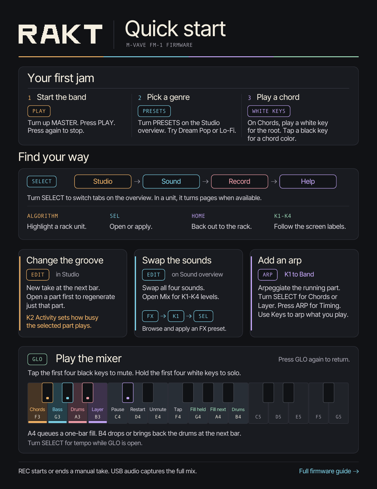
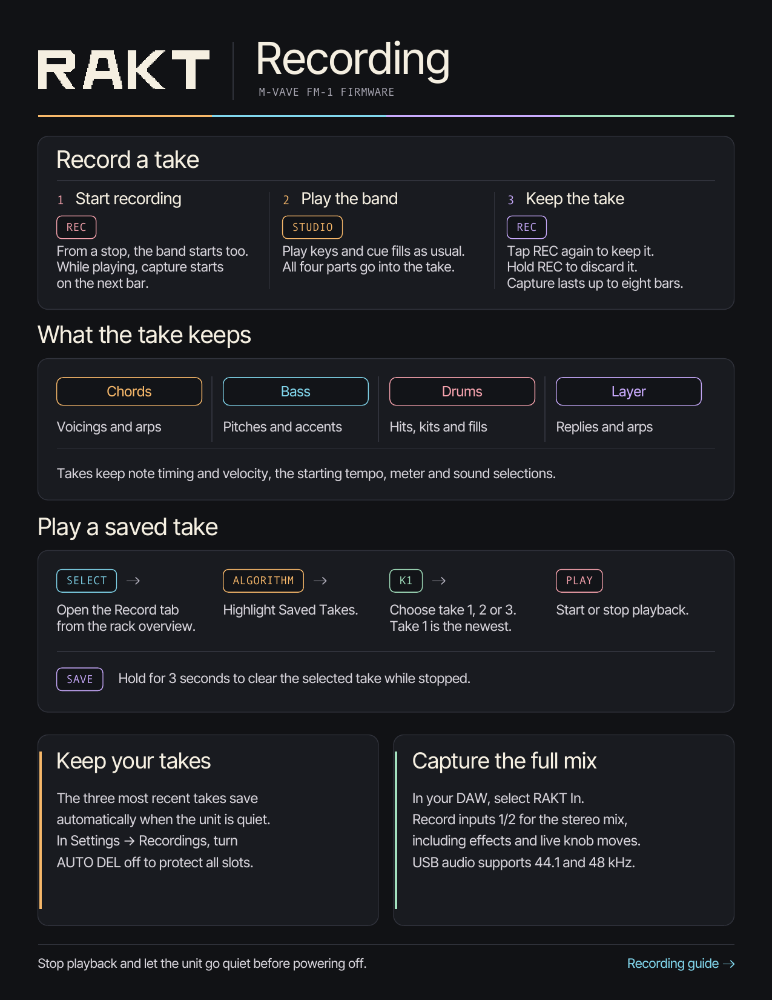

# RAKT · FM-1

**A rack-style chord instrument and groovebox for the M-VAVE FM-1.**

Play chords over a generated band of Chords, Bass, Drums and Layer. The four parts share a progression and clock, and each has its own playing style and sound. Studio lets you shape the band while it plays.

[Play in your browser](https://chasedeanda.github.io/rakt-fm1/play/) · [Install on your FM-1](#install-on-your-fm-1) · [Download the quick-start PDF](docs/RAKT-FM1-Quick-Start.pdf) · [Studio controls](docs/RAKT-STUDIO-CONTROLS.md)

  

The recording cheat sheet below shows the current REC workflow.

  

## How the band plays together

Some styles react to another musician's phrase. In **New Wave**, the Bass **Moving pulse** style accents notes that land with the kick and can pull a nearby note forward to meet it. Switch Drums from **Machine** to **Open hats** to hear the bass accents move. In **Indie**, try Chords **Chop** with Layer **Counterline**. The Layer looks for space between chord hits and shortens its reply when the next chord is close. [Musician styles](docs/RAKT-STUDIO-CONTROLS.md#musician-panel)

Indie also has an eight-bar form. The Layer and hats sit out in bar 5, return in bar 6, and the drums play a turnaround near the end of bar 8. The form runs even with **Evolve** set to zero.

## Shape an arrangement

- **Shuffle the song.** Press **EDIT** on the Studio overview for a new progression, parts, key, scale, meter, and tempo drawn from the selected genre. While playing, the new take starts at the next bar. Zoom into a musician to regenerate just that part. [Studio EDIT](docs/RAKT-STUDIO-CONTROLS.md#harmony-and-shaping)
- **Set the pace of change.** In **Studio → Shaping**, **Energy** adjusts how busy the free parts are. At 50%, it leaves each part at its own Activity setting. **Evolve** varies one eligible part over time. Set it to 0% to keep the current phrases, or turn on **Hold** in a musician's Evolve page to keep just that phrase while the rest of the band changes. [Shaping and Hold](docs/RAKT-STUDIO-CONTROLS.md#harmony-and-shaping)
- **Change the harmony in time.** The Harmony unit queues key and scale changes for the next chord. Meter changes land at the next bar. Studio supports 3/4, 4/4 and 6/8. [Harmony controls](docs/RAKT-STUDIO-CONTROLS.md#harmony-and-shaping)
- **Give the band your own chords.** Open **Studio → Progression → EDIT**. Use **ALGORITHM** to choose a slot and the chord page to set its degree, quality, color and length. On the **Phrase** page, choose **Insert** or **Duplicate** with K1 and press **SEL** to add a slot. Press **PLAY** in the editor to put the draft under all four musicians. The draft keeps its chords, durations and meter when you regenerate a part. [Progression editor](docs/RAKT-STUDIO-CONTROLS.md#custom-progression)

## Give each part its own sound

**Sound → Sound Library** lets you browse within the current genre or open **All sounds**. In Genre mode, **SEL Apply** loads the featured Chords, Bass, Layer and drum kit together. **EDIT** on the Sound overview shuffles tones, kits, and genre-matched FX. Zoom into a musician’s Tone panel to shuffle just that musician’s sound and FX. [Sound library](docs/RAKT-STUDIO-CONTROLS.md#sound) · [Studio Originals listening pack](docs/RAKT-STUDIO-ORIGINALS.md)

Open a part's **Envelope** page to adjust how a pitched sound swells or fades. On **Sends**, set Drive, Chorus, Delay and Reverb for that part. The Studio **Space** control scales the chorus, delay and reverb you have sent to those effects. For example, raise Reverb on Layer and leave the Bass send low to put more depth behind the upper notes. [Sound and effects controls](docs/RAKT-STUDIO-CONTROLS.md#sound)

## Capture a performance

Press **REC** to capture what Chords, Bass, Layer and Drums are playing, including live keys, arpeggios and drum fills. Recording starts with the band from a stop or on the next bar while it plays. Press **REC** again to keep the take, or hold it to discard. The **Record** rack keeps the three latest takes, up to eight bars each. Select a take and press **PLAY** to hear it. Use USB audio for a stereo recording of the full mix and effects. [Record controls](docs/RAKT-STUDIO-CONTROLS.md#record-and-help) · [Recording and backup guide](docs/RECORDINGS.md)

## Play without an FM-1

Open the [browser player](https://chasedeanda.github.io/rakt-fm1/play/) and press **Start** to enable sound. Click or tap the panel, drag or scroll the knobs, or use your computer keyboard.

| Computer control | FM-1 control |
| --- | --- |
| **Q W E R T Y U I O** | Chord roots, with **R = C4** |
| **1–0** and backtick | Chord modifiers and HOLD |
| **Space / Enter** | PLAY / REC |
| **[ / ]** | PRESETS |
| **; / '** | SELECT |
| **, / .** | ALGORITHM |

The page lists the full key map and offers MIDI on supported browsers. Browser saves stay in that browser.

## Install on your FM-1

1. Back up the FM-1's sounds, settings and recordings before switching firmware. Keep a known-working firmware package handy.
2. Open the [RAKT installer](https://chasedeanda.github.io/rakt-fm1/install/) in desktop Chrome or Edge and connect the FM-1 with a USB data cable.
3. The installer selects and checks the latest published RAKT package when one is available. To choose a different build, expand **Another version, or a build of your own** and select a `.fwsc` file from [RAKT releases](https://github.com/chasedeanda/rakt-fm1/releases) or a local build.
4. Verify the selected version, start the install and keep the cable connected and the page open until the FM-1 restarts.

The [Firmware Hub checklist](docs/RAKT-HUB-SUBMISSION.md) documents the package identity, supported flash chips and hardware checks.

## USB audio and MIDI

Select **RAKT In** in your DAW. Inputs **1/2** carry the full stereo mix, **3/4** the Chords stem and **5/6** the Bass stem. Capture supports **44.1 and 48 kHz**. [USB audio setup](docs/USB-AUDIO.md)

Select **RAKT FM-1** for USB MIDI. From Studio, press **GLO → SAVE** for Settings. **MIDI** sets clock and incoming notes, and **Channels** assigns the four parts. To follow an external clock, select **In** and send MIDI Start or Continue.

## Build the firmware

Clone `https://github.com/chasedeanda/rakt-fm1.git` and follow the [build guide](docs/RAKT-BUILD.md) to set up the pinned Python dependencies and JieLi toolchain. Run `./build.sh` from the checkout to produce `build/rakt.fwsc`.

For host checks, run `python3 tools/build.py --gen-only` before the scripts in `tools/test_*.sh`. For a local browser build, run `sh tools/emu/web/build_web.sh` and `python3 tools/make_play_site.py`, then serve `build/play-site` over HTTP. The [emulator guide](tools/emu/README.md) covers the toolchain and test commands.

## More guides

[Harmony](docs/AUTO-HARMONY.md) · [Chord Lab](docs/CHORD-LAB.md) · [Progression catalogue](docs/PROGRESSION-EXPLORER.md) · [Drum grooves](docs/DRUM-LOOPS.md) · [FX presets](docs/FX-PRESETS.md) · [Saved Songs](docs/SONGS-LIBRARY.md) · [Boot animation and chime](docs/RAKT-BOOT.md) · [Diagnostics](docs/DIAGNOSTICS.md) · [Report an issue](https://github.com/chasedeanda/rakt-fm1/issues)

## Credits

The Studio generator and live controls drew on these projects.

- Juan Jiant's generator informed the use of separate seeded parts, bass phrases that respond to the kick pattern, and genre-specific playing styles. His GLO layer informed the live keyboard map. [JIANT FM](https://github.com/juanjiant-bit/JIANT)
- Rastapopolix's work informed independent track behavior and the way phrases evolve over longer spans. [Tessera](https://github.com/Rastapopolix/tessera)
- deamonSLINKY's performance workflow informed how Studio keeps the controls available while the band plays. [PERF-1](https://github.com/deamonSLINKY/PERF-1)

imijes's panel zoom was a visual reference for Studio. The chord controls and strum also draw on Telepathic Instruments' Orchid through RAKT's firmware lineage. [Bass Something 2](https://github.com/imijes/bass-something-2) · [Orchid ORC-1](https://telepathicinstruments.com/products/orchid-orc-1)

RAKT is free software under **GPL-3.0-only**. The firmware inherits work from CORD, CoralFlower, ChoralRoot FM-1 and Felucca, with FM synthesis and drum recipe contributions from Melodee. [Source and asset acknowledgements](LICENSING.md) · [GPL license](LICENSE)
